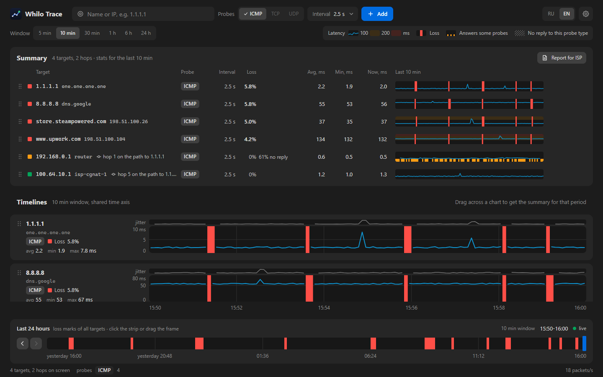
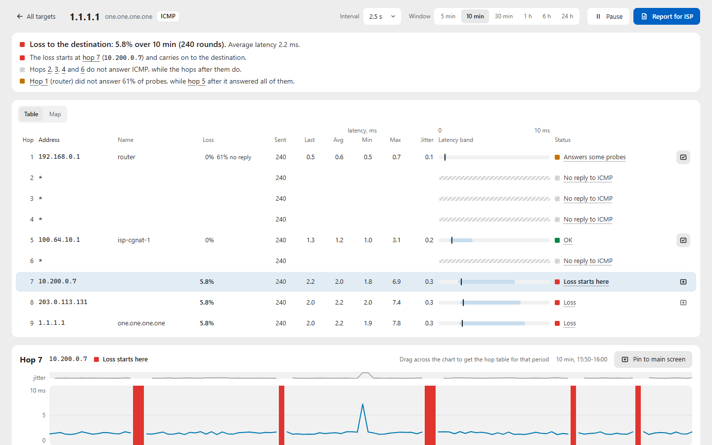
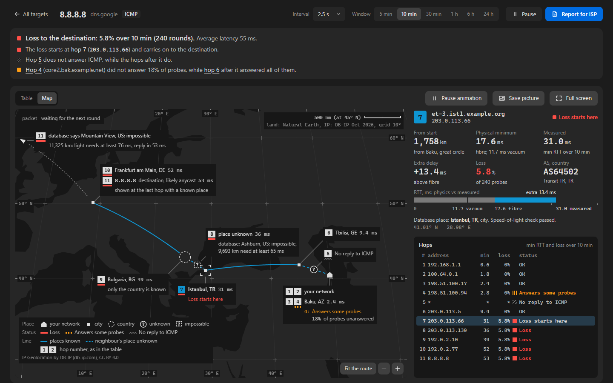

#  Whilo Trace

[](https://github.com/Whilo-Labs/whilo-trace/actions/workflows/ci.yml)
[](https://github.com/Whilo-Labs/whilo-trace/actions/workflows/release.yml)
[](https://github.com/Whilo-Labs/whilo-trace/releases/latest)
[](https://github.com/Whilo-Labs/whilo-trace/releases)
[](#license)


> See where packets get lost on the way to the hosts you care about: per-hop loss and latency for several hosts at once, a timeline from 5 minutes to 24 hours, the route on a world map, local history and a report for your ISP.

[Download](#download) · [Features](#features) · [Screenshots](#screenshots) · [How it works](#how-it-works) · [Route map](#route-map) · [Build](#build-from-source) · [FAQ](#faq)

<picture>
  <source media="(prefers-color-scheme: dark)" srcset="docs/screenshots/main-dark.png">
  <source media="(prefers-color-scheme: light)" srcset="docs/screenshots/main-light.png">
  
</picture>

## Why Whilo Trace

- **Real loss or just a quiet router.** Routers often limit the replies they send about themselves. Whilo Trace tells that apart from loss that carries on to the destination, and points at the hop where the loss starts.
- **One time axis for everything.** All targets and pinned hops share one timeline. When they lose packets at the same moments, the trouble is on the part of the path they share.
- **No administrator rights.** On Windows it uses the system ICMP API and runs as a normal user; the installer does not ask for administrator rights either.

## Features

| Area | What you get |
|---|---|
| **Monitoring** | Several hosts at once, an interval per host from 0.5 to 60 s (2.5 s by default), pause and resume. A round sends one probe per TTL, all in flight together, and rounds overlap, so a short interval holds even when hops stay silent. |
| **Timelines** | A latency line over a background coloured by thresholds (100 and 200 ms by default), solid red columns for loss, amber marks for hops that answer only some probes, hatching for hops that ignore this probe type, a jitter strip and tooltips. Drag across a chart to get the numbers for that period. |
| **Trace** | Findings in plain text, a hop table with neutral statuses and latency bands, and the hop's timeline with the destination under it. Pin any hop to the main screen. |
| **Route map** | The path on a world map, with router places from the DB-IP Lite database that comes with the app: no online maps, and lookups stay on your computer. A speed-of-light check marks the places that the measured round trip rules out. Zoom and pan; a route that crosses an ocean opens on its main part with a pointer to the rest. A packet runs along the route with the target's latest round; full screen; a picture for publishing that hides your addresses and your provider's first hops. |
| **History** | Everything is kept locally in SQLite. A day strip with loss marks opens any moment of the past, also older than 24 hours. |
| **Report for your ISP** | Any period as HTML, PNG, CSV and JSON, with the time zone and the findings, in the interface language. |
| **Interface** | English and Russian; light, dark or system theme; reorder targets by drag and drop, and the order is kept. |

## Screenshots

<picture>
  <source media="(prefers-color-scheme: dark)" srcset="docs/screenshots/trace-dark.png">
  <source media="(prefers-color-scheme: light)" srcset="docs/screenshots/trace-light.png">
  
</picture>

<picture>
  <source media="(prefers-color-scheme: dark)" srcset="docs/screenshots/map-dark.png">
  <source media="(prefers-color-scheme: light)" srcset="docs/screenshots/map-light.png">
  
</picture>

<sub>The screenshots show demo data: addresses other than the public resolvers are from documentation, shared (CGNAT) and private ranges, and the router names and their places are made up.</sub>

## Download

Get the latest version from **[Releases](https://github.com/Whilo-Labs/whilo-trace/releases)**.

| System | File | |
|---|---|---|
| Windows 10 and 11 (x64) | `whilo-trace-*-windows-x64-setup.exe` | Installer for the current user, no administrator rights |
| | `whilo-trace-*-windows-x64-portable.zip` | No installation: unpack and run `whilo-trace.exe` |
| Linux (x86_64) | `whilo-trace-*-linux-x86_64.AppImage` | Make it executable and run it |
| | `whilo-trace_*_amd64.deb` | Debian, Ubuntu and derivatives |
| macOS (Apple silicon and Intel) | `whilo-trace-*-macos-universal.dmg` | Drag the app to Applications |
| Command line, Linux and macOS | `whilo-trace-cli-*.tar.gz` | On Windows it is in the portable zip |

The app downloads include the places database of the [route map](#route-map) (DB-IP Lite, about 130 MB unpacked), so they are larger than before: about 47 MB for the Windows installer, 74 to 77 MB for the portable zip, the deb and the dmg, and 143 MB for the AppImage. The command line downloads do not include it.

> [!NOTE]
> The files are not signed yet. On **Windows**, SmartScreen may say "Windows protected your PC": choose "More info", then "Run anyway". On **macOS**, the app is not notarized yet: open it once, then choose **Open Anyway** in System Settings, Privacy & Security (on macOS 14 and earlier, right-click the app and choose Open). On **Linux**, probes need unprivileged ICMP sockets: if the app says probes are unavailable, run `sudo sysctl -w net.ipv4.ping_group_range="0 2147483647"`.

## Platforms

| Platform | Status |
|---|---|
| Windows 11 | Tested by the author on a real machine |
| Windows 10 | Expected to work (the same system ICMP API), not tested yet |
| Linux | Built automatically, and the core passes the automated tests; not tried on a real machine yet |
| macOS | Built automatically, and the core passes the automated tests; not tried on a real machine yet |

The route map is new in 0.2.0: so far it has been checked only with made-up places, not on real traces.

Found a problem on Linux or macOS? Please [open an issue](https://github.com/Whilo-Labs/whilo-trace/issues/new/choose): reports from those systems help a lot.

ICMP probes and IPv4 only for now. TCP and UDP probes are planned.

## How it works

1. Every round sends one ICMP echo per TTL, from 1 to the length of the path, 25 ms apart and all in flight together. Routers on the way answer "time exceeded", the destination answers with an echo reply.
2. The round keeps who answered at each hop and how fast. Rounds go to SQLite, and every number on screen is computed for the window you are looking at.
3. Each hop gets a neutral status: **OK**; **loss**, when the loss carries on to the destination; **answers some probes**, when the hop limits its own replies while the hops after it answer; **no reply to this probe type**, when it is silent while the hops after it answer; **says the destination is unreachable**, when a router answers that it cannot reach the destination, so the path ends there; **no reply**.
4. The hop where the loss starts is the first one from which the loss carries on to the destination. That is the line to show your ISP.

## Route map

Switch the hop card on the trace screen from **Table** to **Map** to see the path on a world map. The hops are numbered as in the table, and a click on one shows its place, its network (AS) and its speed-of-light check. After a round of the target a packet runs along the route, to the target or to the hop where that round was lost. One packet runs at a time: of the rounds that end while it is on its way, only the newest gets the next one. There is no packet while the animation is paused, a period is picked or the target is paused, and the map starts paused when the system asks for less motion. **Full screen** puts the map over the whole window in the dark theme, and in the app makes the window full screen.

The map reaches down to the bottom of the window while the page is scrolled to the top, with the selected hop and the hop ribbon beside it; when the card is narrower than 1100 px, the map takes the whole width and those two go under it. To zoom, use **+** and **−** at the bottom right of the map, Ctrl with the mouse wheel (a plain wheel scrolls the page, except in full screen) or a double click; drag to pan, and **Fit the route** goes back (with the focus on the map, the keys +, − and 0 do the same). The map zooms out no further than the whole route and in no further than six times the first view or about 300 km across, and the route always stays partly in sight. The view you set stays while new data comes in and goes back to the first view when the route's places change, and a hop you pick in the ribbon or the table that is out of sight is brought into view. A route with a jump of more than 4,500 km between two places in a row, across an ocean, opens on its main part (from home to the last place before the jump) when the whole route would leave that part small: the rest is a dotted pointer at the edge of the map with a callout that numbers its hops and says where they go and about how far that is. **Main part** and **Whole route** switch between the two.

**Save picture** makes a dark picture for publishing, a PNG of 2400×1350 or 2160×2160 pixels (the 1200×675 and 1080×1080 layouts drawn at twice the size): the addresses, names and places of your network and of your provider's first hops (and of any special-purpose addresses among them) are hidden, home is drawn at one point for your whole country instead of at your city, and distances from home are left out. A destination in your provider's network, or one that is the first public hop of the route, keeps its address but shows only its country, and the header shows only what you typed for it. Any other hop, or the destination, that the database puts in your home city or within 50 km of your home also shows only its country and no name, but keeps its address. The home city counts under any of the names the database gives it, for example with a district in brackets or without accents. A destination in your own network is hidden like the rest of it; typed as an address, it is hidden in the header too, and the file name says `route` instead. A report for your ISP saved from the trace screen gets the map too, light and with nothing hidden, drawn from what the screen shows when you save it. The picture and the report's map always show the map's first view (for a long route, its main part with the pointer), however you have zoomed.

- **Places, offline.** Router places and networks come from DB-IP's free IP to City Lite and IP to ASN Lite databases. They come with the app (the installers, the portable zip, the Linux and macOS packages), and a lookup reads only database files on your computer. Special-purpose addresses are never looked up: private, carrier-grade NAT, loopback and link-local ones are your own network and are drawn at home, the other special ranges get no place.
- **Speed-of-light check.** Home is the first hop placed in a city other than the destination, or a point you pick yourself (right-click the map, **Home here**). For every hop placed in a city, the distance from home gives the fastest possible round trip: for light in fibre (two thirds of its speed in vacuum) and in vacuum. The hop's fastest answer in the window is compared with both. Faster than light in fibre is **doubtful**, faster than light in vacuum is **impossible**, with 1 ms of tolerance.
- **New databases.** DB-IP publishes new Lite files every month. When a trace screen first shows the map, the app checks whether a newer month is out: at most one check a day, a failed one included (it is tried again the next day), and only while the database in use is older than the current month or there is none that opens. It asks before downloading anything. The check can be turned off in the settings, **Places database**. On the simulated network the places are made up, and nothing is checked or downloaded.
- **Accuracy.** The Lite databases are less accurate than DB-IP's paid ones (DB-IP's own accuracy index: 77 for City Lite, 96 for its commercial database), and router locations are often wrong. The check catches only gross errors, a place too far away for the measured round trip: a place that passes is possible, not confirmed.

## Build from source

You need Rust stable. Windows also needs the Visual Studio Build Tools with "Desktop development with C++" (MSVC and the Windows SDK); Linux needs the [Tauri prerequisites](https://v2.tauri.app/start/prerequisites/).

```
cargo build --release -p whilo-trace       # desktop app
cargo build --release -p whilo-trace-cli   # command line
```

Build output goes to `.target/` (see `.cargo/config.toml`). Installers come from the Tauri CLI, the same way the [release workflow](.github/workflows/release.yml) makes them: `python tools/fetch_geo.py` downloads the places database into `.target/geo`, then `cd app && npx @tauri-apps/cli@2 build --config tauri.geo.conf.json` puts it into the installer.

A build without that config comes without the places database, and the map offers to download one. To use a local copy instead, set `WHILO_TRACE_GEO_DIR` to the full path of a folder with the databases, such as the repository's `.target/geo` after `python tools/fetch_geo.py` (a relative path is read from the folder the app is started in).

<details>
<summary>Working on the interface without the core</summary>

<br>

The interface (`app/ui`) is plain HTML, CSS and JavaScript without a bundler. Serve `app/ui` with any static file server and open `index.html`: outside the app it runs on a built-in stand-in for the core (`app/ui/base/mock.js`). Address flags:

| Flag | Effect |
|---|---|
| `?mock=live` | a round every 2.5 s, the data moves |
| `?mock=empty` | first run, no targets |
| `?mock=strict` | no trace on the main screen, exactly like the app |
| `?mock=down` | the core does not answer |
| `?mock=geo-new` | the places database is a month old, and the map offers the new one |
| `?mock=geo-none` | no places database: the map has no places and offers to download one |
| `?mock=geo-broken` | the places database cannot be read, and the map offers to download one |
| `?mock=calm` | the system asks for less motion: the map starts without its packet |
| `?theme=dark`, `?lang=en` | check a theme or a language |

Flags combine with commas, as in `?mock=live,geo-new`.

The commands and data between the interface and the core are in [docs/ui-contract.md](docs/ui-contract.md).

</details>

<details>
<summary>Trying the app on a simulated network</summary>

<br>

Start the desktop app with `WHILO_TRACE_SIMULATE` set to any value but `0`, `false`, `no` or `off`, and it runs on a made-up network built into the engine ([crates/engine/src/sim.rs](crates/engine/src/sim.rs)): the app sends no probe and no DNS query. The history goes to `history-sim.db` next to the real one, the window title says the network is simulated, and so does every report saved there. The command line always uses the real network.

A word in the host name picks what its path does:

| Word | Path |
|---|---|
| `loss` | loss on the path from hop 7: a quarter of the rounds lost from there on |
| `flaky` | loss on the path from hop 3: a third of the rounds, 70 seconds in every 5 minutes |
| `down` | the destination never answers |
| `unreachable` | a router reports the destination unreachable |
| `silent` | a router on the way never answers |
| `limit` | a router answers only part of the probes sent to it |
| `far` | a long path, high latency |
| `jitter` | latency spikes from a hop on |

A word counts when it is a whole part of the name between dots or hyphens: `loss.example`, `down.example`, `my-flaky-host.test`, but not `lossless.example`. Any other name or address gets a mix of its own, the same on every run. Addresses of the home network are one hop away, addresses in 192.0.2.0/24 behave as `down`, and names ending in `.invalid` do not resolve.

From the repository root, after `cargo build --release -p whilo-trace`:

```
$env:WHILO_TRACE_SIMULATE = 1; .target\release\whilo-trace.exe; Remove-Item Env:WHILO_TRACE_SIMULATE   # PowerShell
WHILO_TRACE_SIMULATE=1 .target/release/whilo-trace   # bash
```

</details>

## Command line

```
whilo-trace-cli watch 1.1.1.1 8.8.8.8 example.com
whilo-trace-cli trace 1.1.1.1
whilo-trace-cli report 1.1.1.1 --last 6h --tz-offset 240 --out reports
```

The app and the command line share one history (the simulated network keeps its own).

## FAQ

<details>
<summary><b>A hop says "No reply to ICMP". Is it losing my packets?</b></summary>

<br>

Not by itself. Many routers do not answer probes addressed to them while they forward traffic just fine: the hops after them answer. Loss on the path shows up in red and carries on to the destination.
</details>

<details>
<summary><b>Why is a hop amber, "Answers some probes"?</b></summary>

<br>

The router limits how often it answers. If the hops after it answer every probe, the path through it is fine.
</details>

<details>
<summary><b>How much traffic does it send?</b></summary>

<br>

One small probe per hop per round. Three targets at the default 2.5 s come to about 7 packets per second, a few hundred bytes per second in total; the status bar shows the current rate.
</details>

<details>
<summary><b>Where is my history?</b></summary>

<br>

In one SQLite file shared by the app and the command line: `%LOCALAPPDATA%\Whilo Trace\history.db` on Windows, `~/.local/share/whilo-trace` on Linux (or `$XDG_DATA_HOME/whilo-trace`), `~/Library/Application Support/Whilo Trace` on macOS.
</details>

<details>
<summary><b>Where is the places database?</b></summary>

<br>

The one that comes with the app is in the `geo` folder among the program's files: on Windows next to `whilo-trace.exe`, in the install folder or the portable folder; on Linux and macOS inside the package. Its `NOTICE.txt` and `manifest.json` name the month. A newer month downloaded from the map goes to `geo-update` in the folder of the history (see above), and **Remove downloaded** in the settings goes back to the one that came with the app.
</details>

<details>
<summary><b>Does the route map send my addresses anywhere?</b></summary>

<br>

No. Places are looked up in the database files on your computer: the map sends no address of a target or a hop anywhere. (Hop names are another matter: as before the map, they come from reverse DNS, which asks your DNS server about each hop address.) The map asks the network for one thing only, the database file on download.db-ip.com: when a trace screen first shows the map, whether a newer month is out (it asks for the size of that month's file, at most once a day, a failed check included), and the download itself, only after you agree. The check can be turned off in the settings, **Places database**, and the simulated network never makes it.
</details>

## Docs

- [docs/design.md](docs/design.md) (in Russian): architecture, engine, hop classification, storage, export, route map.
- [docs/ui-contract.md](docs/ui-contract.md): commands and data between the interface and the core.

## Similar tools

mtr, WinMTR, Trippy, NextTrace and the commercial PingPlotter. Whilo Trace is written from scratch and shares no code with them.

## License

Licensed under either of [Apache License, Version 2.0](LICENSE-APACHE) or [MIT license](LICENSE-MIT) at your option.

Unless you explicitly state otherwise, any contribution intentionally submitted for inclusion in the work by you, as defined in the Apache-2.0 license, shall be dual licensed as above, without any additional terms or conditions.

The route map uses third-party data and code under their own licenses, listed in [THIRD-PARTY-NOTICES.txt](THIRD-PARTY-NOTICES.txt). The places database is DB-IP City Lite and ASN Lite ([IP Geolocation by DB-IP](https://db-ip.com)) under [CC BY 4.0](https://creativecommons.org/licenses/by/4.0/), and the license above does not cover it. The land outline is Natural Earth (public domain); d3-array, d3-geo, topojson-client and world-atlas are under the ISC license.

<div align="center">
<sub>Part of <b>Whilo Labs</b>, a small series of open-source tools by Firat Baghirli.</sub>
</div>
