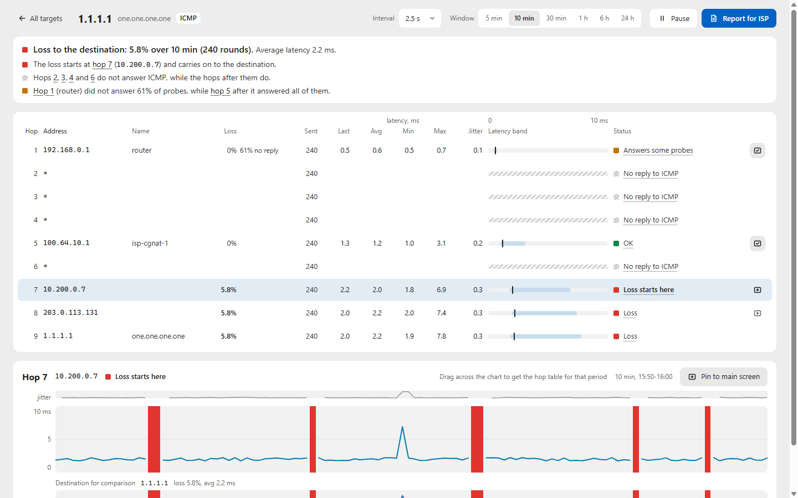

#  Whilo Trace

[](https://github.com/Whilo-Labs/whilo-trace/actions/workflows/ci.yml)
[](https://github.com/Whilo-Labs/whilo-trace/actions/workflows/release.yml)
[](https://github.com/Whilo-Labs/whilo-trace/releases/latest)
[](https://github.com/Whilo-Labs/whilo-trace/releases)
[](#license)


> See where packets get lost on the way to the hosts you care about: per-hop loss and latency for several hosts at once, a timeline from 5 minutes to 24 hours, local history and a report for your ISP.

[Download](#download) · [Features](#features) · [Screenshots](#screenshots) · [How it works](#how-it-works) · [Build](#build-from-source) · [FAQ](#faq)

<picture>
  <source media="(prefers-color-scheme: dark)" srcset="docs/screenshots/main-dark.png">
  <source media="(prefers-color-scheme: light)" srcset="docs/screenshots/main-light.png">
  
</picture>

## Why Whilo Trace

- **Real loss or just a quiet router.** Routers often limit the replies they send about themselves. Whilo Trace tells that apart from loss that carries on to the destination, and points at the hop where the loss starts.
- **One time axis for everything.** All targets and pinned hops share one timeline. When they lose packets at the same moments, the trouble is on the part of the path they share.
- **No administrator rights.** On Windows it uses the system ICMP API and runs as a normal user; the installer does not ask for administrator rights either.

## Features

| Area | What you get |
|---|---|
| **Monitoring** | Several hosts at once, an interval per host from 0.5 to 60 s (2.5 s by default), pause and resume. A round sends one probe per TTL, all in flight together, and rounds overlap, so a short interval holds even when hops stay silent. |
| **Timelines** | A latency line over a background coloured by thresholds (100 and 200 ms by default), solid red columns for loss, amber marks for hops that answer only some probes, hatching for hops that ignore this probe type, a jitter strip and tooltips. Drag across a chart to get the numbers for that period. |
| **Trace** | Findings in plain text, a hop table with neutral statuses and latency bands, and the hop's timeline with the destination under it. Pin any hop to the main screen. |
| **History** | Everything is kept locally in SQLite. A day strip with loss marks opens any moment of the past, also older than 24 hours. |
| **Report for your ISP** | Any period as HTML, PNG, CSV and JSON, with the time zone and the findings, in the interface language. |
| **Interface** | English and Russian; light, dark or system theme; reorder targets by drag and drop, and the order is kept. |

## Screenshots

<picture>
  <source media="(prefers-color-scheme: dark)" srcset="docs/screenshots/trace-dark.png">
  <source media="(prefers-color-scheme: light)" srcset="docs/screenshots/trace-light.png">
  
</picture>

<sub>The screenshots show demo data. Addresses other than the public resolvers and the home router are from documentation and private ranges.</sub>

## Download

Get the latest version from **[Releases](https://github.com/Whilo-Labs/whilo-trace/releases)**.

| System | File | |
|---|---|---|
| Windows 10 and 11 (x64) | `whilo-trace-*-windows-x64-setup.exe` | Installer for the current user, no administrator rights |
| | `whilo-trace-*-windows-x64-portable.zip` | No installation: unpack and run `whilo-trace.exe` |
| Linux (x86_64) | `whilo-trace-*-linux-x86_64.AppImage` | Make it executable and run it |
| | `whilo-trace_*_amd64.deb` | Debian, Ubuntu and derivatives |
| macOS (Apple silicon and Intel) | `whilo-trace-*-macos-universal.dmg` | Drag the app to Applications |
| Command line, Linux and macOS | `whilo-trace-cli-*.tar.gz` | On Windows it is in the portable zip |

> [!NOTE]
> The files are not signed yet. On **Windows**, SmartScreen may say "Windows protected your PC": choose "More info", then "Run anyway". On **macOS**, open the app with right-click, Open, the first time. On **Linux**, probes need unprivileged ICMP sockets: if the app says probes are unavailable, run `sudo sysctl -w net.ipv4.ping_group_range="0 2147483647"`.

## Platforms

| Platform | Status |
|---|---|
| Windows 11 | Tested by the author on a real machine |
| Windows 10 | Expected to work (the same system ICMP API), not tested yet |
| Linux | Built automatically, and the core passes the automated tests; not tried on a real machine yet |
| macOS | Built automatically, and the core passes the automated tests; not tried on a real machine yet |

Found a problem on Linux or macOS? Please [open an issue](https://github.com/Whilo-Labs/whilo-trace/issues/new/choose): reports from those systems help a lot.

ICMP probes and IPv4 only for now. TCP and UDP probes are planned.

## How it works

1. Every round sends one ICMP echo per TTL, from 1 to the length of the path, 25 ms apart and all in flight together. Routers on the way answer "time exceeded", the destination answers with an echo reply.
2. The round keeps who answered at each hop and how fast. Rounds go to SQLite, and every number on screen is computed for the window you are looking at.
3. Each hop gets a neutral status: **OK**; **loss**, when the loss carries on to the destination; **answers some probes**, when the hop limits its own replies while the hops after it answer; **no reply to this probe type**, when it is silent while the hops after it answer; **no reply**.
4. The hop where the loss starts is the first one from which the loss carries on to the destination. That is the line to show your ISP.

## Build from source

You need Rust stable. Windows also needs the Visual Studio Build Tools with "Desktop development with C++" (MSVC and the Windows SDK); Linux needs the [Tauri prerequisites](https://v2.tauri.app/start/prerequisites/).

```
cargo build --release -p whilo-trace       # desktop app
cargo build --release -p whilo-trace-cli   # command line
```

Build output goes to `.target/` (see `.cargo/config.toml`). Installers come from the Tauri CLI, the same way the [release workflow](.github/workflows/release.yml) makes them: `cd app && npx @tauri-apps/cli@2 build`.

<details>
<summary>Working on the interface without the core</summary>

<br>

The interface (`app/ui`) is plain HTML, CSS and JavaScript without a bundler. Serve `app/ui` with any static file server and open `index.html`: outside the app it runs on a built-in stand-in for the core (`app/ui/base/mock.js`). Address flags:

| Flag | Effect |
|---|---|
| `?mock=live` | a round every 2.5 s, the data moves |
| `?mock=empty` | first run, no targets |
| `?mock=strict` | no trace on the main screen, exactly like the app |
| `?mock=down` | the core does not answer |
| `?theme=dark`, `?lang=en` | check a theme or a language |

The commands and data between the interface and the core are in [docs/ui-contract.md](docs/ui-contract.md).

</details>

## Command line

```
whilo-trace-cli watch 1.1.1.1 8.8.8.8 example.com
whilo-trace-cli trace 1.1.1.1
whilo-trace-cli report 1.1.1.1 --last 6h --tz-offset 240 --out reports
```

The app and the command line share one history.

## FAQ

<details>
<summary><b>A hop says "No reply to ICMP". Is it losing my packets?</b></summary>

<br>

Not by itself. Many routers do not answer probes addressed to them while they forward traffic just fine: the hops after them answer. Loss on the path shows up in red and carries on to the destination.
</details>

<details>
<summary><b>Why is a hop amber, "Answers some probes"?</b></summary>

<br>

The router limits how often it answers. If the hops after it answer every probe, the path through it is fine.
</details>

<details>
<summary><b>How much traffic does it send?</b></summary>

<br>

One small probe per hop per round. Three targets at the default 2.5 s come to about 7 packets per second, a few hundred bytes per second in total; the status bar shows the current rate.
</details>

<details>
<summary><b>Where is my history?</b></summary>

<br>

In one SQLite file shared by the app and the command line: `%LOCALAPPDATA%\Whilo Trace\history.db` on Windows, `~/.local/share/whilo-trace` on Linux (or `$XDG_DATA_HOME/whilo-trace`), `~/Library/Application Support/Whilo Trace` on macOS.
</details>

## Docs

- [docs/design.md](docs/design.md) (in Russian): architecture, engine, hop classification, storage, export.
- [docs/ui-contract.md](docs/ui-contract.md): commands and data between the interface and the core.

## Similar tools

mtr, WinMTR, Trippy, NextTrace and the commercial PingPlotter. Whilo Trace is written from scratch and shares no code with them.

## License

Licensed under either of [Apache License, Version 2.0](LICENSE-APACHE) or [MIT license](LICENSE-MIT) at your option.

Unless you explicitly state otherwise, any contribution intentionally submitted for inclusion in the work by you, as defined in the Apache-2.0 license, shall be dual licensed as above, without any additional terms or conditions.

<div align="center">
<sub>Part of <b>Whilo Labs</b>, a small series of open-source tools by Firat Baghirli.</sub>
</div>
