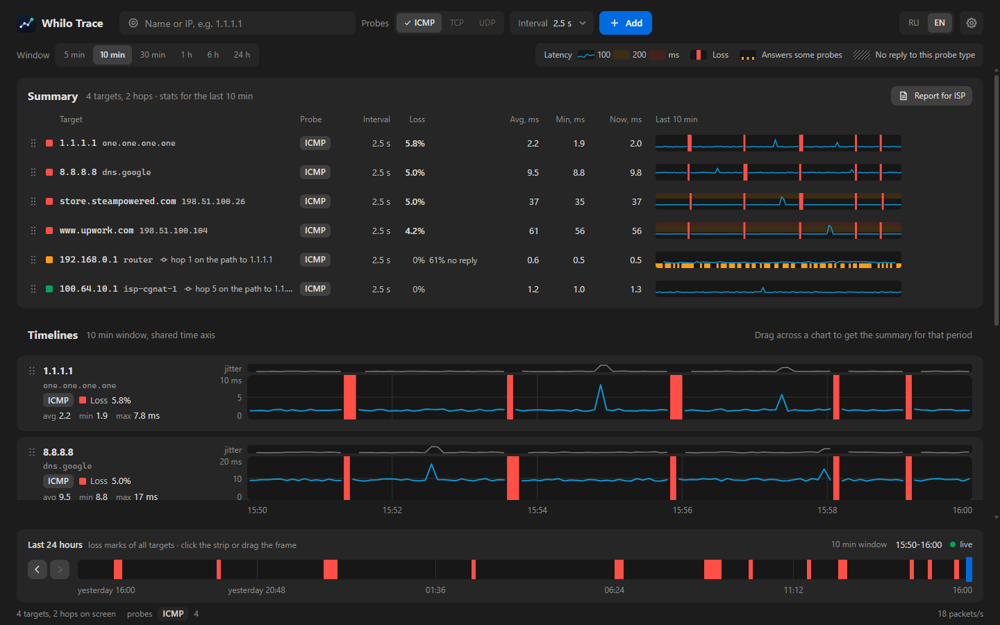

# Whilo Trace

Watch the network path to several hosts at once. Whilo Trace shows loss and latency on every hop in real time, keeps a local history and builds a report you can send to your ISP.



## Why

- It tells a router that only limits its own replies, or ignores probes aimed at itself, apart from real packet loss on the path, and it points at the hop where the loss starts.
- Several targets share one time axis. When they lose packets at the same moments, the problem is on the part of the path they share.
- On Windows it needs no administrator rights.

## Features

- Several targets at once, an interval per target from 0.5 to 60 s (2.5 s by default), pause and resume.
- A round sends one probe per TTL, all in flight together. Rounds overlap, so a short interval holds even when hops stay silent.
- A summary of all targets with small charts and a stack of timelines on a shared time axis; reorder both by drag and drop.
- Timelines: a latency line over a background coloured by thresholds, solid red columns for loss, marks for hops that answer only some probes, hatching for hops that do not answer this probe type, a jitter strip and tooltips.
- Select a period on a timeline to get the numbers for that period.
- Trace screen: findings in plain text, a hop table with neutral statuses, a hop timeline with the destination under it. Pin any hop to the main screen.
- A day strip with loss marks: open any moment of the past, also older than 24 hours.
- A report for your ISP over any period: HTML, PNG, CSV and JSON, in the interface language.
- English and Russian; light, dark or system theme.
- Local history in SQLite, shared by the app and the command line.


## Platforms

| Platform | Status |
|---|---|
| Windows 10 and 11 | tested, no administrator rights (system ICMP API) |
| Linux | builds; unprivileged ICMP sockets (`net.ipv4.ping_group_range`); not tested on a live machine yet |
| macOS | builds; unprivileged ICMP sockets; not tested on a live machine yet |

ICMP probes and IPv4 only for now. TCP and UDP probes are planned.

## Build

Requires Rust stable. Windows needs the Visual Studio Build Tools with "Desktop development with C++" (MSVC and the Windows SDK). Linux needs the [Tauri prerequisites](https://v2.tauri.app/start/prerequisites/).

```
cargo build --release -p whilo-trace       # desktop app
cargo build --release -p whilo-trace-cli   # command line
```

Build output goes to `.target/` (see `.cargo/config.toml`).

On Linux, allow unprivileged ICMP sockets for your group, for example `sudo sysctl -w net.ipv4.ping_group_range="0 2147483647"`.

The interface (`app/ui`) is plain HTML, CSS and JavaScript without a bundler. To work on it without the core, serve `app/ui` with any static file server and open `index.html`: it runs on a built-in stand-in for the core. Add `?mock=live` for moving data, `?mock=empty` for the first run, `?theme=dark` or `?lang=en` to check a theme or a language.

## Command line

```
whilo-trace-cli watch 1.1.1.1 8.8.8.8 example.com
whilo-trace-cli trace 1.1.1.1
whilo-trace-cli report 1.1.1.1 --last 6h --tz-offset 240 --out reports
```

## Docs

- [docs/design.md](docs/design.md) (in Russian): architecture, engine, hop classification, storage, export.
- [docs/ui-contract.md](docs/ui-contract.md): commands and data between the interface and the core.

## Similar tools

mtr, WinMTR, Trippy, NextTrace and the commercial PingPlotter. Whilo Trace is written from scratch and shares no code with them.

## License

Licensed under either of

- Apache License, Version 2.0 ([LICENSE-APACHE](LICENSE-APACHE))
- MIT license ([LICENSE-MIT](LICENSE-MIT))

at your option.

Unless you explicitly state otherwise, any contribution intentionally submitted for inclusion in the work by you, as defined in the Apache-2.0 license, shall be dual licensed as above, without any additional terms or conditions.

Whilo Trace is part of Whilo Labs, a small series of open-source tools by Firat Baghirli.
